# Ulanzi TC001 Evolved 🚀 (Slovenská dokumentácia)

[](https://platformio.org/)
[](https://www.espressif.com/)
[](LICENSE)
[](https://github.com/hackra76/Ulanzi-TC001-Evolved/releases)
[](https://youtube.com/shorts/nju1VtkFuw0?feature=share)

Pokročilý firmvér novej generácie pre originálne inteligentné stolové pixelové hodiny **[Ulanzi TC001 Smart Pixel Desktop Clock](https://www.ulanzi.com/products/ulanzi-pixel-smart-clock-2882?_pos=1&_psq=clock&_psid=1e85ab0a9&_ss=e)** (vyrábané spoločnosťou Shenzhen Ulanzi Technology Co., Ltd.) bežiaci na mikrokontroléri ESP32 s **8×32 WS2812B RGB LED maticou**, senzorom Sensirion SHT30, adaptívnym jasom (LDR), sledovaním finančných trhov, akcií a kryptomien, živým leteckým radarom (ADS-B), predpoveďou počasia, YouTube štatistikami, prispôsobiteľným Awtrix rozložením hodín a duálnym OTA systémom aktualizácií.

🌐 **Jazyky:** [English (Predvolený)](README.md) • [English Zrkadlo](README_EN.md) • [Slovenčina](README_SK.md)

<a href="https://buymeacoffee.com/hackra" target="_blank"></a>

---

## 🎬 Video ukážka

<div align="center">
  <a href="https://youtube.com/shorts/nju1VtkFuw0?feature=share" target="_blank">
    
  </a>
  <p>▶️ <b><a href="https://youtube.com/shorts/nju1VtkFuw0?feature=share">Pozrieť na YouTube Shorts: Why Everyone is Hacking This $40 Smart Clock</a></b></p>
</div>

---

## 🖥️ Galéria obrazoviek a možnosti displeja

RGB LED matica 8×32 WS2812B NeoPixel vykresľuje telemetriu a informácie s vysokým vizuálnym kontrastom, zjednoteným 3×5 písmom a precíznymi 8×8 ikonami.

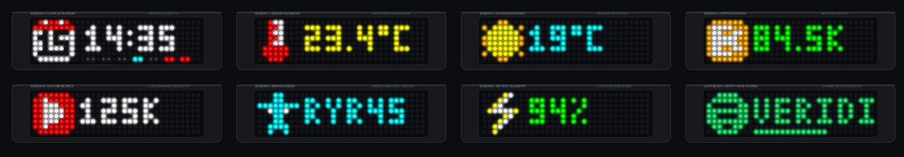

| Obrazovka & Funkcia | Živý náhľad matice | Popis a technické možnosti |
|---|:---:|---|
| **Obrazovka 0: Hodiny a Kalendár** | 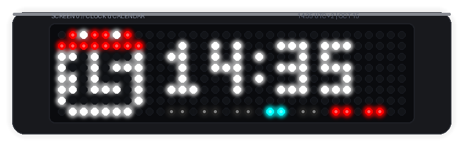 | Dynamická karta kalendára (deň 1–31 v štýle Awtrix), digitálny 3×5 čas a 7 pásikov dní v týždni s vlastnými farbami pre aktívny deň, neaktívne dni a víkendy. |
| **Obrazovka 1: Vnútorné prostredie** | 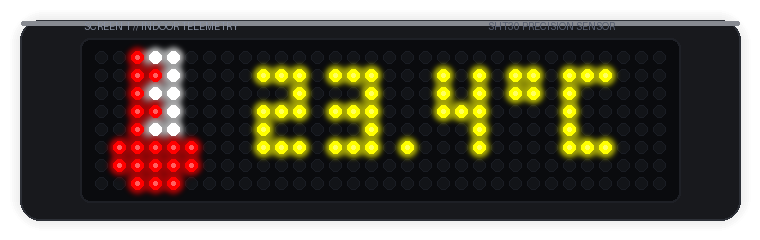 | Presná telemetria zo senzora Sensirion SHT30 v reálnom čase (teplota v `°C` a vlhkosť) cez hardvérovú I2C zbernicu. |
| **Obrazovka 2: Vonkajšie počasie** | 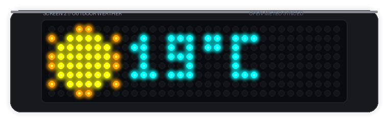 | Živá predpoveď z Open-Meteo s WMO ikonami počasia (Slnko, Oblaky, Dážď, Sneh, Búrka) a viac ako 25 prednastavenými mestami. |
| **Obrazovka 3: Finančné trhy a Krypto** | 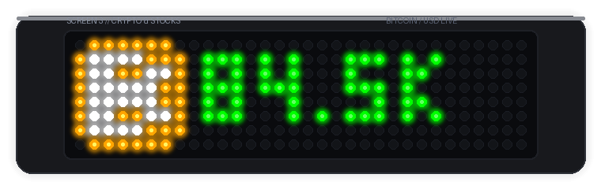 | Živý cenový ticker bez nutnosti API kľúčov pre Bitcoin, Ethereum, Solana, Apple, Tesla, Nvidia, S&P 500, Zlato a vlastné burzové symboly. |
| **Obrazovka 4: YouTube štatistiky** | 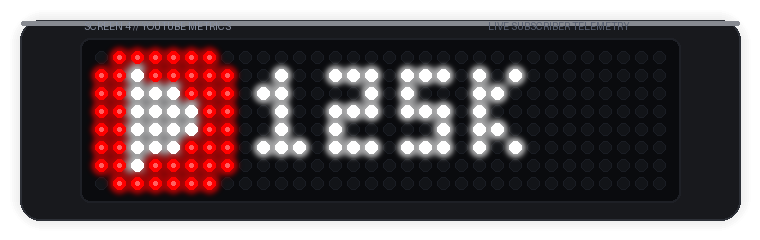 | Živé počítadlo odberateľov YouTube kanála s prepracovanou vycentrovanou bielou ikonou prehrávača cez Google Data API v3. |
| **Obrazovka 5: Živý letecký radar** | 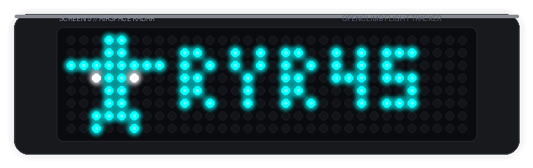 | Sledovanie prelietavajúcich lietadiel v reálnom čase (ADS-B) cez OpenSky Network v okruhu ~50 km s tyrkysovou ikonou lietadla. |
| **Obrazovka 6: Telemetria batérie** | 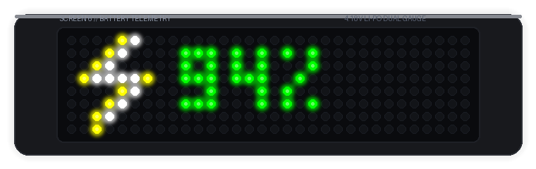 | Výrazná neónovo žltá/biela ikona blesku s voliteľným režimom: Percentá (`93%`), Napätie (`4.12V`) alebo Striedanie. |
| **Obrazovka 7: Stopky a Odpočítavanie** | 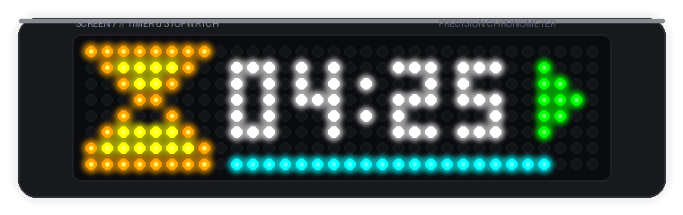 | Dvojitý chronometer (Stopky s desatinami sekundy a Odpočítavanie so zvukovým alarmom, dynamickým progress barom a stavovým odznakom). |
| **Obrazovka 8: Retro šetriče obrazovky** | 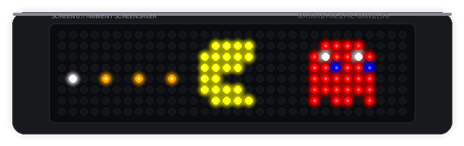 | Procedurálne animácie s nulovou alokáciou na heape: Matrix digitálny dážď, Doom oheň / termálna láva, Pac-Man arkádová naháňačka a Conwayova hra života. |
| **Vlastná aplikácia: Spotify & Notifikácie** | 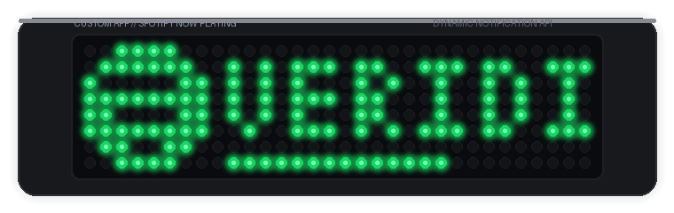 | Dynamické MQTT / REST push API so zelenou ikonou Spotify, plynule rolujúcim názvom skladby a spodným ukazovateľom priebehu (progress bar). |

---

## ✨ Kľúčové funkcie

- **🎛️ Priemyselný Webový portál (Tactile Field Instrument):**
  - Postavený na princípoch priemyselného dizajnu **Tactile Field Instrument** (estetika Braun / Teenage Engineering / Švajčiarska mriežka).
  - Telemetrická lišta s vysokou hustotou dát: živý Wi-Fi RSSI signál, stav flash pamäte a čas behu zariadenia v monospace hlavičkách.
  - Taktilné ovládacie prvky: precízne mechanické prepínače, vrúbkované posuvníky, zapustené prístrojové karty a živé zrkadlenie 32×8 NeoPixel matice.
  - **Rozdelené do 4 logických panelov**: **Displej a Hodiny**, **Obrazovky a Rotácia**, **Dátové Služby a Integrácie** a **Sieť a Systém**.
  - **Dvojjazyčná podpora**: Okamžité prepínanie medzi **slovenčinou** a **angličtinou** (`[EN | SK]`) s trvalým uložením voľby v `localStorage` aj v NVS pamäti (`ui_lang`).
  - **Priamy odkaz na GitHub**: Verzia v hlavičke (`v2.1.0 • GitHub`) vedie priamo na oficiálny repozitár a vydania.
  - **Integrácia podpory vývojára**: Interaktívny plávajúci widget Buy Me a Coffee a akčné tlačidlá v hlavičke a pätičke portálu.
  - Automatický prechod do SoftAP režimu (`Ulanzi-Setup-XXXX`) s presmerovaním na captive portál na adrese `192.168.4.1`.
  - Neinvazívny skener okolitých Wi-Fi sietí s ukazovateľom sily signálu (RSSI) a bleskovým ukladaním cez AJAX.
- **📶 Pamäť viacerých Wi-Fi sietí & Inteligentný roaming:**
  - Ukladá až 4 profily bezdrôtových sietí do NVS pamäte (Profil 01 Primárna, Profil 02 Sekundárna, Profil 03 Hotspot, Profil 04 Záložná).
  - Rýchly 2,4 GHz RF skener pri štarte (~1,5s) automaticky rozpozná dostupné uložené siete a pripojí sa k sieti s najsilnejším signálom RSSI (plynulé prenášanie medzi domovom, kanceláriou a mobilným hotspotom).
  - Automatické opätovné pripojenie na pozadí pri strate signálu s postupným prepínaním uložených profilov pred aktiváciou SoftAP.
  - Kompletná REST API podpora cez `GET /api/wifi` a priradenie slotov na jeden klik vo webovom portáli (Panel 04).
- **📺 Živý stream displeja & Virtuálna matica:**
  - Zrkadlenie 32×8 NeoPixel displeja v reálnom čase priamo vo webovom portáli s automatickou obnovou každých 1,5s.
  - Export snímky displeja do BMP na jeden klik (`/api/display/screenshot`).
  - Textová ASCII art reprezentácia displeja (`/api/display/text`).
  - Tlačidlá na manuálne prepínanie obrazoviek priamo z prehliadača.
- **⏰ Awtrix-Style Hodiny & Dátum:**
  - 3 režimy zobrazenia: Iba čas, Kombinovaný čas a dátum (striedanie 5s/3s) alebo Iba dátum.
  - **7 pásikov dní v týždni s farebným odlíšením víkendov**:
    - 11 farieb pre aktívny deň (Tyrkysová, Oranžová, Zelená, Žltá, Červená, Biela, Purpurová, Elektrická modrá, Limetková, Zlatá, Ružová).
    - 10 farieb pre neaktívny deň (Tlmená aktívna farba Auto, Sivá bridlicová, Tlmená jantárová, Tmavomodrá, Hlboké víno, Lesná zelená, Uhlíková, Tlmená fialová, Tmavá azúrová, Vypnuté/čierna).
    - Samostatný výber farby pre víkendy (11 možností) s automatickým kontrastom neaktívnych víkendových dní.
    - Začiatok týždňa v pondelok (ISO 8601) alebo v nedeľu.
  - Formáty dátumu: `DD.MM.`, `DD MMM`, `MM/DD`, `DAY DD`.
  - Štýly ikon hodín: Dynamický 9×8 kalendár (zobrazuje deň 1–31 s dedikovanou 1px medzerou a symetrickým orámovaním, čím úplne eliminuje zlievanie dvojciferných dátumov ako 22/23), Srdiečko, Ciferník alebo Plná šírka bez ikony.
  - Zobrazenie sekúnd: Plná šírka s vycentrovaným časom `HH:MM:SS` a dvojbodkami; pri zapnutých sekundách sa ikona automaticky skryje pre dokonalú čitateľnosť.
  - Zjednotené kompaktné 3×5 písmo na všetkých obrazovkách (Hodiny, Počasie, Trhy, Radar, Batéria, Vlastné aplikácie) s 1px horným okrajom a čistým oddelením od pásikov dní a progress barov.
- **✈️ Živý letecký radar (ADS-B):**
  - Sledovanie prelietavajúcich lietadiel v reálnom čase cez OpenSky Network v okruhu ~50 km okolo nastavených GPS súradníc počasia.
  - Automatické striedanie volacích znakov (Callsign) lietadiel každé 4 sekundy s tyrkysovou ikonou lietadla.
  - Zobrazenie zeleného nápisu `"CLEAR"`, ak je vzdušný priestor voľný.
- **⚡ Telemetria batérie a energie:**
  - Výrazná neónovo žltá a biela ikona blesku (`ICON_LIGHTNING`).
  - Voliteľný formát zobrazenia: Iba percentá (`93%`), Iba napätie (`4.12V`) alebo automatické striedanie každé 3 sekundy.
- **📈 Finančné trhy, akcie, komodity a krypto:**
  - Verejné trhové kanály bez nutnosti registrácie API kľúčov.
  - Kryptomeny: `BTC`, `ETH`, `SOL`, `BNB`.
  - Akcie a indexy: Apple (`AAPL`), Tesla (`TSLA`), Nvidia (`NVDA`), S&P 500 (`SPX`).
  - Forex a komodity: Zlato (`GOLD`), `EUR/USD`, `USD/EUR`.
  - Možnosť zadania vlastného burzového tickera s dynamickým farebným akcentom.
- **▶️ YouTube kanál & Odberatelia:**
  - Živý počet odberateľov z Google Data API v3.
  - Prepracovaná výrazná biela ikona prehrávania (play button) v červenej pilulke.
- **🌤️ Skutočné vonkajšie počasie:**
  - Živé meteorologické údaje z bezplatného Open-Meteo API (nevyžaduje žiadny API kľúč).
  - Mapovanie WMO kódov počasia na animované 8×8 ikony (Slnko, Oblaky, Dážď, Sneh, Búrka).
  - **Zoznam prednastavených miest:** Viac ako 25 prednastavených miest (Slovensko, Česko, Európa, Svet) s automatickým vyplnením GPS súradníc.
- **💡 Adaptívny jas & Nočný režim:**
  - Plynulý automatický jas riadený fotorezistorom (LDR) s filtrom EMA a nelineárnou gama krivkou.
  - Denný strop jasu (5% – 100%) a Nočný jas (1% – 25%).
  - Konfigurovateľné tiché nočné hodiny s ultra-tlmeným, neoslňujúcim čistým tmavočerveným vycentrovaným časom (bez rušivého žltého mesiaca pre ničím nerušený spánok).
  - Rýchle prebudenie: Stlačenie ľubovoľného tlačidla v noci dočasne rozsvieti displej na 12 sekúnd na denný jas.
- **🎛️ Zoradenie obrazoviek kolotoča:**
  - Tlačidlá `▲` / `▼` vo webovom portáli na zmenu poradia obrazoviek podľa vlastného výberu.
  - Samostatné zaškrtávacie políčka na aktiváciu alebo deaktiváciu ktorejkoľvek obrazovky.
  - Vlastné poradie sa ukladá do NVS (`car_ord`) a riadi automatickú rotáciu aj tlačidlá.
  - Nastaviteľný interval rotácie (3 až 120 sekúnd).
  - Okamžité ukladanie cez AJAX s plávajúcou notifikáciou bez opustenia portálu.
- **🎬 Efekty prechodu obrazoviek:**
  - Výber z 8 plynulých animácií pri zmene obrazoviek vo webovom portáli:
    - **Žiadny (Okamžitý prepis)**: Bez animácie.
    - **Posun doľava (Slide Left)**: Plynulý horizontálny posun vľavo (krok 2 px, 16 fáz).
    - **Posun doprava (Slide Right)**: Plynulý horizontálny posun vpravo.
    - **Posun nahor (Slide Up)**: Vertikálny posun zdola nahor (8 fáz).
    - **Posun nadol (Slide Down)**: Vertikálny posun zhora nadol.
    - **Prelínanie (Crossfade / Dissolve)**: 10-krokové plynulé prelínanie farieb cez natívny 24-bitový GRB double-buffer.
    - **Opona (Curtain Split Wipe)**: Rozdelenie a odhalenie novej obrazovky od stredu k okrajom.
    - **Náhodný (Random)**: Automatický náhodný výber prechodového efektu pri každej zmene.
  - Priamy zápis do vyrovnávacej pamäte eliminuje preblikávanie a zachováva plný jas bez straty intenzity.
- **🏠 Home Assistant MQTT Auto-Discovery:**
  - Natívna integrácia bez manuálnej konfigurácie: automaticky vytvorí 12 synchronizovaných entít v Home Assistante po pripojení k MQTT brokeru.
  - Senzory: SHT30 Teplota (`°C`), Vlhkosť (`%`), Batéria (`%`), Napätie batérie (`V`), Osvetlenie, Aktívna obrazovka.
  - Ovládacie prvky: Svetlo matice (Zapnutie/Vypnutie a posuvník jasu 0–255), Prepínač automatického jasu, Prepínač automatického kolotoča, Výber obrazovky, Tlačidlo pípania bzučiaka, Tlačidlo reštartu.
  - Živý stav pripojenia a konfiguračné polia brokera priamo vo webovom portáli.
- **🎵 Custom App Push API & Spotify Integrácia:**
  - **Dynamické obrazovky**: Odosielanie vlastných obrazoviek cez MQTT (`<prefix>/custom/<nazov>`) alebo HTTP REST (`POST /api/custom?name=<nazov>`).
  - Prijaté obrazovky (napr. aktuálne prehrávaná skladba Spotify, stav 3D tlačiarne, časovač) sa dynamicky zaradia do rotácie kolotoča.
  - **Funkcie správ**: Text, 8×8 ikony (vstavané `spotify`, `bell`, `lightning`, `youtube` atď., alebo 64 farebných hodnôt RGB565), farby, 1-pixelový spodný progress bar (0–100%), vlastná dĺžka zobrazenia a automatické vypršanie (lifetime).
  - **Čistá typografia bez kolízií**: Text sa posúva na riadkoch 0–6 pri aktívnom progress bare na riadku 7 bez prekrývania.
  - **Pripnuté ikony**: Ľavá ikona zostáva fixne na vrchu s vyčistenými stĺpcami 0–8, takže rolujúci text plynule mizne za ňou.
  - **🚨 Prioritné notifikácie**: Okamžité výstrahy cez `POST /api/notify` alebo `<prefix>/notify`, ktoré prerušia aktívnu obrazovku so zvukovým signálom a po skončení vrátia pôvodný obsah.
- **⏱️ Presné Stopky a Odpočítavanie času:**
  - **Dvojitý režim (Dual Engine)**: Plnohodnotné Stopky (meranie času `MM:SS.t` s desatinami sekundy) a Odpočítavanie (`MM:SS` s dynamickým spodným progress barom a stavovým odznakom).
  - **Akustický a vizuálny alarm**: Pulzujúci 2.4 kHz piezo bzučiak a blikajúci zvonček na matici po vypršaní času, okamžite vypnuteľný stlačením ľubovoľného tlačidla.
  - **Zámok rotácie obrazoviek (Carousel Lock)**: Automatický kolotoč obrazoviek sa automaticky pozastaví počas behu stopiek alebo odpočítavania, aby sa obrazovka svojvoľne neprepla.
  - **Taktilný ovládač vo Webovom portáli**: Interaktívny ovládací panel vo webovom rozhraní s rýchlymi predvoľbami (1m, 3m, 5m, 10m, 15m), prepínačom režimu a živým zrkadlením stavu.
  - **Vzdialené REST API**: Plné ovládanie cez `GET /api/timer` alebo `POST /api/timer` (`action=start|pause|toggle|reset`, `mode=stopwatch|countdown`, `duration=<sekundy>`).
- **👾 Retro Ambient šetriče obrazovky (Screensavers):**
  - **Procedurálne enginy s nulovou alokáciou na heape**:
    - **Matrix digitálny dážď**: Kyberpunkový dážď zeleného fosforového kódu s jasne svietiacimi bielymi čelnými iskrami.
    - **Doom oheň / Termálna láva**: Klasická simulácia horenia z Doom/PSX s fyzikálnym vzostupom tepla a dynamickými žeravými uhlíkmi na spodnom riadku.
    - **Pac-Man & Blinky (80s Arcade)**: Arkádová naháňačka s animovaným otváraním úst, bodkami, energizérom a zraniteľným modrým duchom.
    - **Conwayova hra života (Game of Life)**: Celulárny automat v reálnom čase s farebným odlíšením veku buniek (tyrkysová -> smaragdová -> žltá -> purpurová) a automatickým znovuzrodením pri stagnácii alebo vymretí.
    - **Dynamické striedanie (Shuffle)**: Automatické prepínanie všetkých 4 štýlov každých 25 sekúnd.
  - **Dva spôsoby aktivácie**:
    - **Obrazovka v kolotoči (Obrazovka 8)**: Bežná súčasť rotačného cyklu popri hodinách, počasí a kurzoch.
    - **Aktivácia pri nečinnosti**: Automatické zapnutie šetriča po nastaviteľnom čase bez stlačenia tlačidiel (1, 2, 5, 10, 15 alebo 30 minút) s okamžitým prebudením ľubovoľným tlačidlom.
  - **Samostatné REST API**: Plná automatizácia cez `GET /api/screensaver` a `POST /api/screensaver` (`style=0..4`, `timeout=0..60`, `action=start|stop`).
- **🔄 Duálny Over-The-Air (OTA) aktualizačný systém:**
  - Priame nahrávanie `.bin` súboru priamo z webového prehliadača cez `/update` s ukazovateľom priebehu v percentách.
  - 1-Klik aktualizácia priamo z GitHub Releases (`/api/ota/check`, `/api/ota/install`).
  - Živé zobrazenie priebehu inštalácie v percentách priamo na 8×32 LED displeji (`OTA: XX%`).

---

## 🎛️ Fyzické ovládanie zariadenia

| Tlačidlo | Akcia | Funkcia |
|---|---|---|
| **Vľavo** (GPIO 26) | Krátke stlačenie | Prepnutie na predchádzajúcu obrazovku podľa vlastného poradia (pozastaví rotáciu) |
| **Vpravo** (GPIO 14) | Krátke stlačenie | Prepnutie na nasledujúcu obrazovku podľa vlastného poradia (pozastaví rotáciu) |
| **OK / Stred** (Obrazovka šetriča) | Krátke stlačenie | Cyklické prepínanie retro štýlov šetriča (Matrix, Oheň, Pac-Man, Život, Shuffle) |
| **OK / Stred** (Obrazovka batérie) | Krátke stlačenie | Prepnutie zobrazenia telemetrie batérie medzi Napätím (V) a Percentami (%) |
| **OK / Stred** (Obrazovka trhov) | Krátke stlačenie | Cyklické prepínanie predvolieb aktív (BTC, ETH, SOL, BNB, AAPL, TSLA, NVDA, SPX, ZLATO, EUR, USD) |
| **OK / Stred** (Obrazovka časovača) | Krátke stlačenie | Spustenie / Pozastavenie (Toggle) stopiek alebo odpočítavania |
| **OK / Stred** (Ostatné obrazovky) | Krátke stlačenie | Cyklická zmena manuálneho jasu (10% → 35% → 80%) |
| **OK / Stred** (Globálne dlhé stlačenie) | Dlhé stlačenie (>700ms) | Zapnutie / vypnutie automatického kolotoča obrazoviek (na časovači: reset / prepnutie režimu) |
| **Vľavo** (Obrazovka časovača) | Dlhé stlačenie (>700ms) | Skrátenie času odpočítavania o -1 minútu (pri zastavenom stave) |
| **Vpravo** (Obrazovka časovača) | Dlhé stlačenie (>700ms) | Predĺženie času odpočítavania o +1 minútu (pri zastavenom stave) |
| **Ľubovoľné tlačidlo** | Stlačenie pri zvonení alarmu | Okamžité stíšenie a vypnutie alarmu odpočítavania |
| **Ľubovoľné tlačidlo** | Stlačenie počas šetriča | Okamžité prebudenie displeja a návrat k aktívnemu kolotoču |
| **Ľubovoľné tlačidlo** | Stlačenie v nočnom režime | Dočasné prebudenie displeja na 12 sekúnd na denný jas |

---

## 🌐 Webové konfiguračné rozhranie

Portál je dostupný na adrese `http://<ip-adresa-zariadenia>/` (alebo `http://192.168.4.1/` v režime nastavenia):

1. **Živý náhľad displeja:** Reálny 32×8 canvas stream a tlačidlo na stiahnutie BMP snímky.
2. **Wi-Fi Sieť:** Skenovanie okolitých sietí a ukladanie prístupových údajov.
3. **Svetelný senzor & Obrazovka:** Automatický jas, denný a nočný strop, tiché nočné hodiny.
4. **Kolotoč obrazoviek & Prechody:** Zmena poradia pomocou tlačidiel `▲`/`▼`, výber aktívnych obrazoviek a výber z 8 prechodových efektov (Posun, Prelínanie, Opona, Náhodný).
5. **Formát batérie:** Percentá, Napätie alebo Striedanie každé 3 sekundy.
6. **Rozloženie hodín a dátumu:** Režim hodín, zobrazenie sekúnd, stĺpce dní, farby, formát dátumu a ikona.
7. **Predpoveď počasia:** Výber mesta zo zoznamu alebo vlastné GPS súradnice.
8. **Finančné trhy a krypto:** Výber akcie, indexu, komodity alebo kryptomeny, prípadne vlastný ticker.
9. **YouTube Štatistiky:** ID kanála alebo @handle a Google Cloud API kľúč.
10. **Home Assistant & MQTT:** Nastavenie IP brokera, portu, prístupových údajov a predpony témy so živým indikátorom pripojenia.
11. **Aktualizácia firmvéru (OTA):** Flash lokálneho `.bin` súboru alebo kontrola nových verzií na GitHube.

---

## 🔌 Hardvérová architektúra a zapojenie pinov

| Komponent | Súčiastka | GPIO Pin | Popis |
|---|---|---|---|
| **Displej** | WS2812B NeoPixel | **GPIO 32** | Matica 8×32 (256 LED, cik-cak zapojenie stĺpcov) |
| **Senzor (I2C)** | Sensirion SHT30 | **GPIO 21 (SDA), GPIO 22 (SCL)** | Teplota a vlhkosť, I2C adresa `0x44` |
| **Svetelný senzor** | LDR fotorezistor | **GPIO 33** | ADC1 CH5 s EMA filtrom |
| **Snímanie batérie** | Li-ion telemetria | **GPIO 34** | ADC1 CH6 s odporovým deličom 1:1 |
| **Bzučiak** | Piezo menič | **GPIO 15** | Tónová signalizácia bez blokovania slučky |
| **Ľavé tlačidlo** | Taktilný spínač | **GPIO 26** | Aktívne v nule (LOW), interný pull-up |
| **Stredné tlačidlo** | Taktilný spínač | **GPIO 27** | Aktívne v nule (LOW), interný pull-up |
| **Pravé tlačidlo** | Taktilný spínač | **GPIO 14** | Aktívne v nule (LOW), interný pull-up |
| **Napájanie** | Li-ion akumulátor | — | Kapacita 4400 mAh s nabíjaním cez USB-C |

---

## 🛠️ Zostavenie a nahratie firmvéru

### Požiadavky
- [PlatformIO Core](https://platformio.org/) alebo PlatformIO IDE (rozšírenie pre VS Code)

### Kompilácia firmvéru
```powershell
pio run -e ulanzi-tc001
```

### Nahratie cez USB kábel (Windows PowerShell)
Vždy nastavte kódovanie konzoly na UTF-8 na ochranu pred pádmi Pythonu:
```powershell
$env:PYTHONIOENCODING="utf8"; pio run -e ulanzi-tc001 -t upload
```

### Sledovanie sériového portu (Monitor)
```powershell
pio device monitor -b 115200
```

---

## 📦 Zostavené vydania (Releases)

Predkompilované binárne súbory sú k dispozícii v sekcii [Releases](https://github.com/hackra76/Ulanzi-TC001-Evolved/releases):
- `firmware.bin`: Súbor pre OTA aktualizáciu cez webové rozhranie alebo GitHub 1-klik aktualizáciu.
- `firmware.factory.bin`: Kompletný obraz pamäte pre prvotné nahratie cez USB od adresy `0x0000`.

---

## 🙏 Poďakovanie a kredit hardvéru

Tento projekt je nezávislý komunitný open-source firmvér navrhnutý pre **Ulanzi TC001 Smart Pixel Clock**, pôvodne vyvinutý a vyrábaný spoločnosťou **[Shenzhen Ulanzi Technology Co., Ltd. (Ulanzi)](https://www.ulanzi.com/)**.

- **Originálne hardvérové zariadenie**: [Ulanzi Pixel Smart Clock (TC001)](https://www.ulanzi.com/products/ulanzi-pixel-smart-clock-2882?_pos=1&_psq=clock&_psid=1e85ab0a9&_ss=e)
- **Hardvérové inžinierstvo**: Veľká vďaka patrí spoločnosti **Ulanzi** za vytvorenie kvalitného, cenovo dostupného a pre komunitu otvoreného stolného zariadenia na báze ESP32 s maticou 8×32 WS2812B, senzorom Sensirion SHT30 a integrovanou Li-ion batériou.
- **Inšpirácia a ekosystém**: Poďakovanie patrí aj celej open-source komunite pixelových hodín a ekosystému **Awtrix** za priekopníctvo v oblasti maticových displejov.

> [!NOTE]
> *Upozornenie: Ulanzi TC001 Evolved je nezávislý komunitný open-source projekt a nie je oficiálne prepojený, schválený ani sponzorovaný spoločnosťou Shenzhen Ulanzi Technology Co., Ltd. Názov „Ulanzi“ a označenie modelu „TC001“ sú ochrannými známkami príslušných vlastníkov.*

---

## 📄 Licencia
Tento projekt je otvorený softvér pod licenciou MIT.
